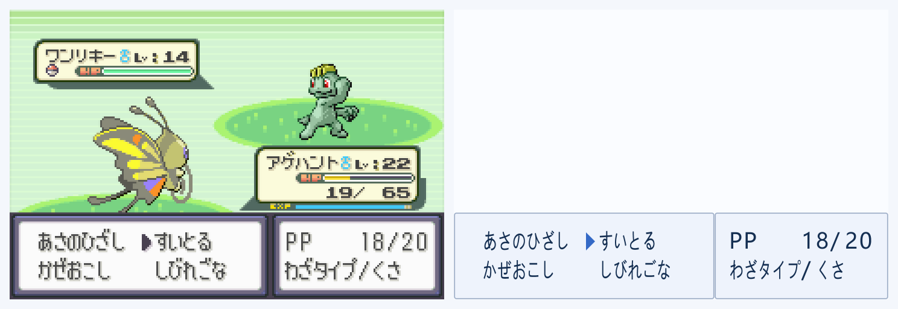

# 战斗菜单光标与未知字重叠修复

输入为用户提供的 [问题截图](reported-screen.png)。游戏区域按 [input.json](input.json) 的视口和像素中心规则提取，作为独立回归素材；不改变 S3 冻结集的分母。

问题已复现：右列选择光标位于 `(72,120)`，落入原来连续读取两列招式的文字网格。它是原生战斗光标图形，与字库中的 `▶` 不同，原始读取输出为：

```text
あさのひざし �すいとる
かぜおこし しびれごな
```

显示层同时识别到了光标，因此蓝色箭头与红色未知字重叠。

## 修复

[BattleCursor](../../desktop/src/main/java/io/github/rsocr/desktop/BattleCursor.java)使用已有、两份日版 ROM 核查过的原生光标掩码，只处理已定位战斗菜单中的专用选择槽。识别前在文字输入副本中分离确认的光标，原始捕获图保持完整，由显示层绘制当前选择。

实时内容指纹同样分离光标。只移动选择且文字不变时，保留当前日文；选择箭头仍随当前画面更新。PP、类型或文字实际变化继续按对应区域处理。该输入处理同时接入桌面图片识别路径。未知文字、非菜单位置及未严格匹配的图形不作光标清除。

修复后原始日文为：

```text
あさのひざし すいとる
かぜおこし しびれごな
```

## 验证

- 19 项自动检查通过，新增 3 项回归覆盖用户问题图、四个招式选项位置及光标移动、真实未知字保留和未确认图形保留。
- 对原有全部 456 张截图，分离光标后的识别结果与冻结引擎结果一致；579 个原有区域的基线没有修改。
- 原始捕获图片不变；当前选择只有一个蓝色箭头，光标槽不再输出未知字文字单元。
- S3 冻结的 471 个文件、原识别 JAR 和桌面包内 14 个识别类／资源保持一致，见 [制品检查](artifact-checks.json)。

[详细前后结果](checks.json)保留原始区域、文字、文字单元及显示指针。以下为该问题图经过实际 JavaFX 画布绘制的快照，属于静态与构造位置回归，不是新增的实机连续链路验收。

修复前：


修复后：



桌面 JAR 已重新构建。关闭现有窗口后，仍使用根目录的 [start-desktop.cmd](../../start-desktop.cmd) 启动，再选择捕获窗口并开始实时。
