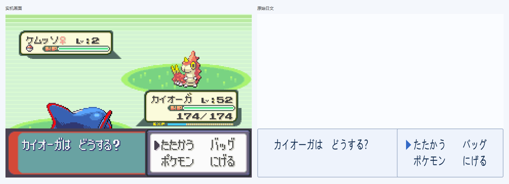
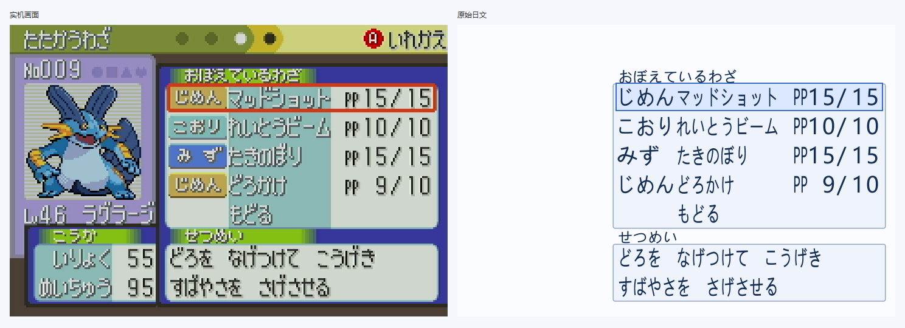

# S4 独立窗口与原始日文显示

2026-11-02。S4 的离线窗口实现与布局检查完成。窗口读取现有实机截图，按原框位置显示 OCR 原始日文。实时捕获、连续帧有效性、中文和发行包仍按 S5～S8 推进。

本文保留 S4 当时的检查及制品身份。当前版本另已接入 [S5 实时窗口捕获](../s5-live/README.md)，启动脚本相同；S4 的原始 9 项检查和制品哈希不改写为新版结果。

## 已实现

- JavaFX 独立系统窗口，保留标题栏、移动及大小调整能力；结果按 GBA 240×160 等比缩放，剩余空间留边。
- 打开 PNG／目录、上一张／下一张、重新识别、停止；自动适配当前 NDS／NGC 截图，也可显式选择配置。原图对照可关闭，诊断按需展开。
- 根据已核查的原生框体几何、文字坐标及层叠顺序绘制，保留列表和数值的列位置。检测 ROI 只负责文字归属，不将复合页面的 ROI 虚构为实体窗口。
- 保留菜单三角箭头和摘要招式的可见选择边框。普通箭头使用冻结字体；战斗箭头从两份固定日版 ROM 分别核查；摘要高亮根据当前图像中连续红色边框观察，不由文字、文件名或历史结果推断。
- 切图先清除旧内容；停止及错误清除结果；旧任务迟到时不能回写当前图片。可表示空框、识别中和移除状态。

## 检查结果及边界

| 检查 | 结果 | 证据性质 |
| --- | --- | --- |
| 全部当前实机截图的显示映射 | 456 张、579 区域、13,322 个文字单元；原文未改写，所有单元均在所属区域内 | 实际离线 OCR＋布局扫描，见 [layout-checks.json](layout-checks.json) |
| 当前可见选择 | 38 个三角箭头、10 个招式选择边框 | 当前图片像素观察，不推断不可见选择 |
| 多框、覆盖、列表、数值／性格／招式页 | 10 对原图／结果；每组另生成竖向空间布局，共 20 张 | JavaFX 实际绘制快照 |
| 空框、识别中、停止移除 | 3 张快照 | 明确构造状态，未冒充实机连续帧 |
| 状态、过期任务、空框、比例、原生框体和选择 | 9 项通过 | 自动检查，见 [artifact-checks.json](artifact-checks.json) 与 `desktop/src/test/` |
| 桌面启动及显示 | 原图与日文对照可读；观察到第 27、30 张及随后最小化 | Windows 桌面观察，见 [ui-checks.json](ui-checks.json) |
| S3 冻结输入 | 471 个文件全部一致，冻结识别 JAR 哈希不变；桌面包中 14 个识别类／资源字节一致 | 制品比对，没有重新冻结 S3 |

窗口移动／大小调整由原生系统窗口提供；比例和可读性使用不同宽高的实际 JavaFX 渲染检查。桌面自动输入因用户同时操作被工具取消；鼠标拖动、最大化按钮和所有文件对话框路径未独立自动操作，未将取消的动作记为通过。

本报告不宣称真实捕获时序、两条连续链路、逐字／翻页响应或完整中文链路的 200ms 目标通过。界面中的“离线处理”只是单张读取及 OCR 耗时。

## 运行和复现

需要 Windows、Java 21 和已有根目录识别 JAR。桌面模块独立构建，避免本次窗口工作重建 S3 冻结识别程序。

当前机器可直接双击项目根目录的 [start-desktop.cmd](../../start-desktop.cmd)。启动器自动检查 Java 版本，跳过默认 Java 8，复用本机已有的 Java 21；也支持 `JAVA_HOME`、项目 `.tools/jdk*` 和 PATH 中的 Java 21 或更新版本。启动成功后命令窗口退出；失败时保留错误信息。窗口打开后点击“打开图片”或“打开目录”选择素材。

```powershell
# 根目录识别程序的构建方式见离线识别开发报告；已有 S3 制品时不必重建。
./build-desktop.ps1 -JavaHome '你的 JDK 21 目录'
./run-desktop.ps1 -JavaHome '你的 JDK 21 目录' -Directory './gba_testcase'
./run-desktop.ps1 -JavaHome '你的 JDK 21 目录' -Directory './ngc_testcase'
```

也可用 `-Image` 打开单张。Ctrl+O 打开、Alt+左／右切图、F5 重新识别。自动适配 1200×800、1600×1200、240×160；其他尺寸明确报错并清除旧结果，尚不提供任意截图标定。

本机使用已有 JDK `D:/Code/Workspace/g1-ocr/.tools/jdk21.0.9_10` 和 Maven 仓库 `D:/Code/Workspace/g1-ocr/.tools/m2`；构建增加 `-MavenRepository` 和 `-Offline` 即可。尚未制作免安装运行时。

```powershell
& '你的 JDK 21 目录/bin/java.exe' '-Djavafx.cachedir=.tools/javafx-cache' -cp 'desktop/target/test-classes;desktop/target/rs-ocr-desktop-0.1.0.jar' io.github.rsocr.desktop.SnapshotCheck $PWD
python tools/check_desktop_artifact.py
```

[元数据提取](../../tools/build_presentation.py)仅在开发期读取已有几何调查及固定 ROM；[战斗光标依据](../../desktop/src/main/resources/cursors.json)记录两作哈希、原生流偏移和解码哈希。普通窗口只读取 Java、桌面 JAR 和打开的图片；制品检查确认没有打包 ROM、测试截图、答案或参考源码。

## 显示样例

以下为实机图片经 JavaFX 画布实际绘制的对照快照，不是桌面操作录像。





[普通对白](dialogue.png) · [列表加对白](list-dialogue.png) · [列表加操作菜单（竖向）](list-action-tall.png) · [数值页](stats.png) · [性格页](personal.png) · [状态图](condition.png) · [状态图文字被挡时](condition-covered.png) · [识别中（构造）](state-pending.png) · [空框（构造）](state-empty.png) · [移除（构造）](state-removed.png)
